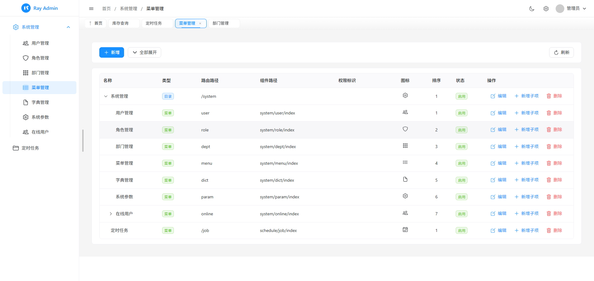
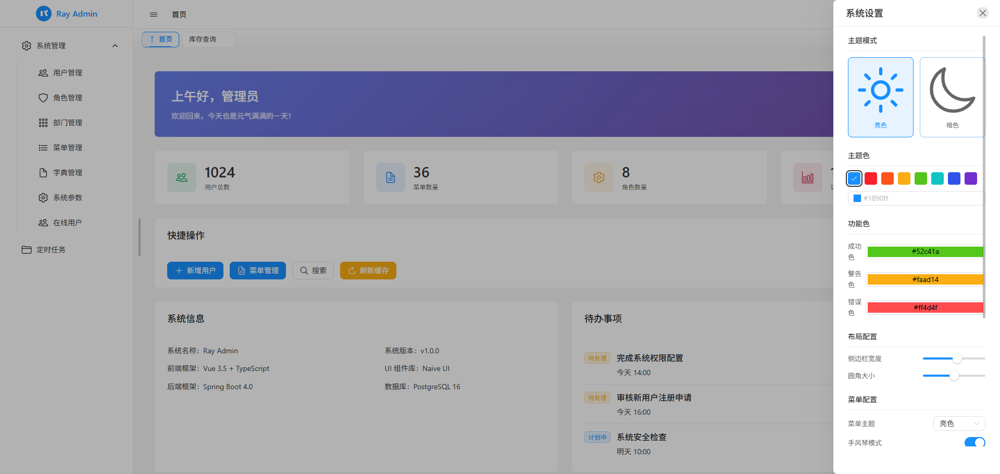

# Ray Web

一个基于 Vue 3.5 + Naive UI 的企业级后台管理系统前端方案。

## 简介

Ray Web 是采用 Vue 3.5、TypeScript 5.7、Vite 6 和 Naive UI 构建的后台管理系统前端模板。配套后端项目请参考 [Ray Boot](https://github.com/hanhan721/ray-boot)。

项目内置了完善的权限管理、动态路由、通用业务组件以及规范的开发流程，旨在提供一个稳定、高效的开发起点。

## 主要特性

- **技术栈**: Vue 3.5 (Composition API) + Vite 6 + Pinia 2.3 + TypeScript 5.7
- **UI 框架**: 基于 Naive UI，提供完整的类型支持与主题定制能力
- **开发效率**: 集成 `unplugin-auto-import` 和 `unplugin-vue-components` 实现 API 和组件的自动按需引入
- **业务组件**: 内置 ProTable（封装搜索/表格/分页）、DictSelect（字典集成）、DeptTree（部门树）等常用组件
- **权限控制**: 支持菜单、按钮级别的权限管理，提供声明式指令
- **规范标准**: 严格的 ESLint/Prettier 配置，集成 vue-tsc 进行全量类型检查

## 界面预览

| 登录页 | 控制台 |
| :--- | :--- |
|  |  |

## 技术栈清单

- **核心**: Vue 3.5, Vue Router 4.5, Pinia 2.3
- **工具**: Vite 6, TypeScript 5.7, Axios, Sass
- **UI**: Naive UI 2.43
- **扩展**: @tsparticles (动画效果), vue-draggable-plus (拖拽组件)

## 目录结构

```text
src/
├── api/            # 接口定义
├── components/     # 公共组件
├── hooks/          # 组合式函数
├── layouts/        # 页面布局
├── router/         # 路由配置
├── stores/         # 状态管理
├── styles/         # 全局样式
├── types/          # 类型声明
├── utils/          # 工具函数
└── views/          # 业务页面
```

## 环境要求

- Node.js >= 18.0.0
- pnpm >= 8.0.0

## 快速开始

```bash
# 安装依赖
pnpm install

# 启动开发服务器
pnpm dev

# 项目打包
pnpm build

# 代码检查与修复
pnpm lint
pnpm format
```

## 开发指南

项目开发规范及最佳实践请参阅 [CLAUDE.md](./CLAUDE.md)。

- 遵循 `script setup` 语法规范
- 页面组件需定义 `name` 选项以支持调试与缓存
- 优先复用 `src/components/common` 中的基础组件
- API 请求统一封装在 `src/api` 目录下

## 授权协议

[MIT License](./LICENSE)
